# Olá! Eu sou o Leo 👋

**Estudante de Análise e Desenvolvimento de Sistemas**

☕ Focado em Java e suas aplicações  
💻 Estudando programação e desenvolvimento de software  
🚀 Construindo projetos e evoluindo um passo de cada vez

---

## 👾 Meu gráfico de contribuições

<picture>
  <source
    media="(prefers-color-scheme: dark)"
    srcset="https://raw.githubusercontent.com/LeoSouzaCode/LeoSouzaCode/output/pacman-contribution-graph-dark.svg">
  <source
    media="(prefers-color-scheme: light)"
    srcset="https://raw.githubusercontent.com/LeoSouzaCode/LeoSouzaCode/output/pacman-contribution-graph.svg">
  
</picture>

---

*Obrigado pela visita! ⭐*

